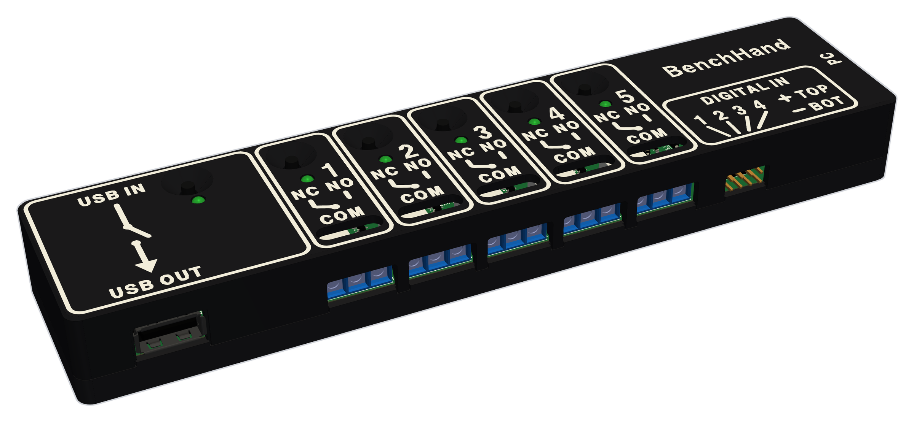
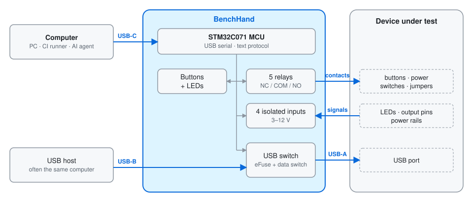
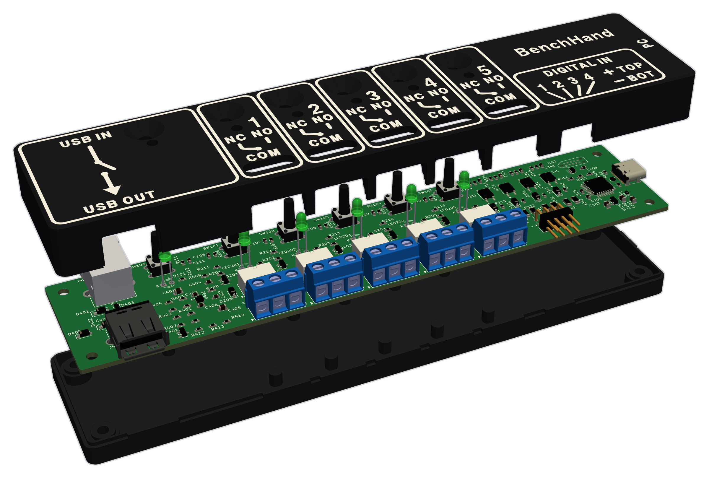

<!-- SPDX-License-Identifier: CC-BY-SA-4.0 -->
<!-- Copyright (c) 2026 Martin Faltus (mafaltu) -->

<h1 align="center">BenchHand</h1>

<p align="center"><b>Remote hands for your test bench</b><br>
Press buttons, flip switches, power-cycle boards, unplug USB and read signals from a script, a CI job or an AI agent.</p>

<p align="center">
  
</p>

<p align="center">
  <a href="hardware/LICENSE"></a>
  <a href="firmware/LICENSE"></a>
  <a href="enclosure/LICENSE"></a>
  
</p>

---

## What is it?

BenchHand is a small USB box that sits between your computer and the hardware you are developing. It gives the
computer what it has always lacked on a test bench: **hands and eyes**.

- **5 relays** (potential-free contacts NC / COM / NO) can do anything a hand or a switch would. They press any button
  on the device, stand in for a switch, power-cycle a small board, apply a voltage to an input, or set a jumper or strap
  pin. They are signal relays (1 A at up to 30 V DC), made for low-voltage bench signals, not for mains or heavy loads.
- **A switched USB 2.0 passthrough** (480 Mbit/s) unplugs and replugs a USB device or programmer in software, power and
  data, with no hand on the cable.
- **4 isolated digital inputs** (3-12 V) are the eyes. They watch an LED, an output pin, a status line or a power rail
  of the device under test, so you can check that it actually reacted.
- **Physical buttons and LEDs** let a human take over at any time.
- **One USB serial port** with a plain-text protocol works from any language, a shell script, a CI pipeline, or an AI
  agent that just types `HELP`.

## Why this exists

Hardware development has a dirty secret: the automation stops at the USB cable.

Your scripts can build, flash and test. Your CI can run all night. Your AI agent can debug firmware for hours. And then,
sooner or later, somebody has to **press a button**, **hold BOOT while plugging in USB**, **unplug the device and plug it
back in**, **flip a switch**, **power-cycle the target**, or **check whether that LED actually lit up**.

That somebody is a human. Humans aren't at the desk 24/7, don't answer in milliseconds, get bored of pressing the same
button for the 40th time, and occasionally go to sleep. So the whole automated pipeline sits and waits.

BenchHand removes the human from that loop, so automation can run all the way to the hardware.

## A taste of it

```text
> ID?
< OK model=BenchHand hw=r1 fw=0.1.0 proto=1 sn=005900A75943501420363441
> PULSE 1 200                         # press "reset" (relay 1) for 200 ms
< OK
> SEQ SET 2 ON; DELAY 50; SET 1 ON; DELAY 100; SET 1 OFF; DELAY 50; SET 2 OFF
< OK steps=7 delay_ms=200 async=0     # hold BOOT, tap RESET, release BOOT
> USB DISCONNECT 2000                 # unplug the USB device for 2 s, then plug it back in
< OK
> INPUT?
< OK in=0,0,0,0 rise=0,0,0,0 fall=0,0,0,0
```

What people do with it (the list is open, a relay contact plus an input can stand in for a lot):

| Use | How |
|---|---|
| **Press any button** | reset, boot, power, a menu key, a doorbell: a relay contact across the button |
| **Flip a switch** | anything that is just a contact: a door contact, a limit, reed or float switch, an on/off status line; or move an analog input between fixed points by switching resistors (e.g. a "cold" and a "hot" NTC value) |
| **Apply a signal** | switch a voltage onto an input of the device and check that the firmware notices |
| **Power-cycle** | restart a low-power board that hangs, or interrupt its supply to test brown-out recovery (signal relays: 1 A / 30 V DC max) |
| **Re-plug USB** | re-enumerate a device or programmer, test hot-plug handling, without touching the cable |
| **Watch the result** | read LEDs, output pins or rails on the isolated inputs, and count edges |
| **Close the loop** | flash an ESP32 / STM32 / RP2040, put it into its bootloader, reset it and verify it, unattended, from CI or an AI coding agent |

## Features

| | |
|---|---|
| **Control port** | USB-C, USB 2.0 Full Speed CDC ACM (no driver on Linux, macOS or Windows 10+) |
| **Relays** | 5 x SPDT (NC / COM / NO) on screw terminals, signal relays rated 1 A at up to 30 V DC (low-voltage use only, no mains), coil-state LED per relay |
| **USB passthrough** | USB-B in, USB-A out, USB 2.0 High Speed (tested at 480 Mbit/s), eFuse-protected VBUS with fault latch, software-switched data and power |
| **Inputs** | 4 x optically isolated, 3-12 V = HIGH, edge detection (`rise=` / `fall=`) |
| **Safety** | relays auto-release after `MAX_ON` (default 60 s), everything off on reset and on host sleep, watchdog |
| **Protocol** | text lines, exactly one `OK` / `ERR` reply per command, self-documenting `HELP`, sequences (`SEQ`) |
| **MCU** | STM32C071 (Cortex-M0+), crystal-less USB, firmware update over USB DFU |
| **Board** | 188.8 x 40 mm, 2 layers, all SMD on one side, designed for home assembly (stencil + hot plate / reflow) |
| **Enclosure** | 3D-printed, two parts, two-colour lid with labels (single colour works too) |

## How it works

<p align="center">
  <picture>
    <source media="(prefers-color-scheme: dark)" srcset="docs/images/block-diagram-dark.svg">
    
  </picture>
</p>

The hardware design is described in [hardware/docs](hardware/docs/README.md), and the reasons behind the main choices
are collected in [docs/design-decisions.md](docs/design-decisions.md).

## For AI agents

BenchHand is a USB device that gives a program hands on a test bench. It has 5 relays (dry contacts NC / COM / NO) to
press buttons or reset and power-cycle a device under test (DUT). It has 4 isolated digital inputs (3-12 V = HIGH) to
read DUT signals. And it has a switched USB 2.0 passthrough (USB-B in, USB-A out) to unplug and replug a programmer or
USB device. You control it with plain-text lines over a USB serial port (CDC ACM).

**Port.**
- Linux: `/dev/serial/by-id/usb-mafaltu_BenchHand_<serial>-if00`.
- macOS: `/dev/cu.usbmodem*` (not tested).
- Windows: a `COMn` port, USB ID `1209:0001` (not tested). Match on the name `BenchHand`, not on the PID.

If several boards are connected, ask the user which one to use, and match the `sn=` field of `ID?`.

**Open.**
- Linux shell: run `stty -F <port> raw -echo` first.
- Python: use `serial.Serial(port, timeout=1)`. Baud rate, parity and DTR / RTS are ignored.
- Only one program at a time. Use `flock <port> <cmd>` if several programs may open the port.

**Protocol.**
- One command per line (LF, CR or CRLF), at most 320 characters, case-insensitive, channels by number (relays 1-5,
  inputs 1-4).
- Exactly one reply per command, in order: zero or more data lines starting with `# `, then one final line starting
  with `OK` or `ERR`. Read until that final line.
- Errors look like `ERR <code> <reason>: <hint>`, and the hint says how to fix the call.
- `HELP` lists the commands, and `HELP <command>` gives details and examples.

**Rules you must respect.**
1. **Ask what is wired.** The board does not know what a relay or input is connected to. Ask the user (e.g. "relay 1 =
   DUT reset to GND, input 1 = status LED") and use only those channels.
2. **Relays switch real circuits.** Never switch a relay you were not told about. A relay switched ON from the port
   turns OFF by itself after `MAX_ON` (60 s by default). Send `SET <n> ON` again as a keep-alive. Change `MAX_ON` only
   if the user agrees.
3. **After a board reset everything is off**, except the USB passthrough, which comes back ON.
4. **Host sleep turns everything off.** So does Linux USB autosuspend while no program has the port open. Keep the
   port open or ask the user about the udev rule in the [firmware README](firmware/README.md).
5. **Unplugging through the passthrough is not a safe eject.** Unmount mass-storage devices first.
6. **`ext=1` in `STATUS?`** means foreign voltage is present on the USB-A output. Tell the user.
7. **Inputs take 3-12 V.** Never ask the user to connect more than 12 V.
8. **`REBOOT` / `BOOTLOADER`** reply `OK` and then drop the port. Re-open it after about 1 s. Use `BOOTLOADER` (USB DFU
   firmware update) only when asked.

Minimal Python client:

```python
import glob, serial
port = glob.glob("/dev/serial/by-id/usb-mafaltu_BenchHand_*-if00")[0]
p = serial.Serial(port, timeout=1)

def cmd(line):
    p.write((line + "\n").encode())
    reply = []
    while True:
        l = p.readline().decode().rstrip("\r\n")
        reply.append(l)
        if l.startswith(("OK", "ERR")):
            return reply

print(cmd("ID?"))
print(cmd("HELP"))
```

The full agent guide, including the table of all commands of the current protocol version, is
[firmware/docs/agent_quickstart.md](firmware/docs/agent_quickstart.md). The complete reference is
[firmware/docs/PROTOCOL.md](firmware/docs/PROTOCOL.md), and the board's own `HELP` is authoritative.

## Build your own

| Step | What | Where |
|---|---|---|
| 1. PCB | Order the 2-layer board from the Gerbers (any standard prototype fab) | [hardware/fabrication](hardware/fabrication/) |
| 2. Parts | Universal BOM: key specs, substitutes, Mouser / DigiKey / TME / LCSC codes | [hardware/bom](hardware/bom/README.md) |
| 3. Assembly | Stencil + reflow for the SMD side, then the through-hole parts | [assembly notes](hardware/fabrication/benchhand-r1-assembly-notes.md) |
| 4. Firmware | Build with CMake + arm-none-eabi-gcc, flash over SWD once, then over USB DFU | [firmware](firmware/README.md) |
| 5. Enclosure | Print the two parts (generic 3MF / STEP), insert 4 screws | [enclosure](enclosure/PRINTING.md) |

<p align="center">
  
</p>

## Repository layout

```text
hardware/   KiCad 10 project, fabrication files, BOM, hardware docs and known issues
firmware/   STM32C071 firmware (TinyUSB, ST HAL), protocol, agent guide
enclosure/  parametric CadQuery enclosure, print-ready 3MF / STEP, print guide, renders
docs/       design decisions
```

Clone with submodules: `git clone --recurse-submodules https://github.com/mafaltu/benchhand`

## How this was made

**Short version: AI built it. I dreamed it.**

AI agents (Claude Code and OpenAI Codex) generated every schematic symbol, every copper trace, every line of firmware,
every design review, every page of documentation and every curve of the 3D-printed enclosure in this repository. Yes, this README
too.

I'm the spiritual leader of the operation. The idea, the vision of what a bench tool like this should be, and the
direction of the project are mine. I led the AI the way an experienced developer leads a team, and it did the rest.
The one thing it didn't do is solder the board. *Yet.*

It was also an experiment: how far can AI take a complete hardware product, from an idea to a working device on the
bench? Pretty far, it turns out.

**It isn't perfect.** Revision 1 works, but I'd do a few things differently next time. See
[known issues](hardware/docs/known-issues.md). Found something else? Open an issue.

## Licence

BenchHand is open source hardware. You may build it, change it and sell it. If you distribute a modified version,
you must publish your changes under the same licence and credit the original project.

| Part | Licence |
|---|---|
| Hardware (`hardware/`) | [CERN-OHL-S-2.0](hardware/LICENSE) |
| Firmware (`firmware/`) | [GPL-3.0-or-later](firmware/LICENSE). Bundled libraries keep their own licences (TinyUSB MIT, ST HAL BSD-3-Clause, CMSIS Apache-2.0). |
| Enclosure, docs, images | [CC BY-SA 4.0](enclosure/LICENSE) |

"BenchHand" is the name of this project. Clones and derivatives are welcome, but please don't sell them under the
name BenchHand.

Copyright (c) 2026 Martin Faltus (mafaltu)
