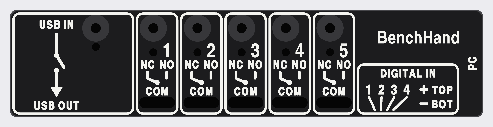

# BenchHand enclosure - print and assembly guide

Two printed parts hold the BenchHand board (USB-DEBUG-CTRL r1): a **bottom** tray and a **lid** with all
openings and the panel graphics. Any FDM printer with a 200 x 50 mm bed area works; no printer-specific settings
are needed.

## Files

| File | Use |
|---|---|
| `out/generic/benchhand_enclosure.3mf` | **Start here.** Plain 3MF without slicer or printer settings, parts already in print orientation: `lid` = `lid_body` (black) + `lid_labels` (white, two parts of one object), `bottom` |
| `out/generic/benchhand_enclosure_step.zip` | STEP of `bottom`, `lid`, `lid_labels` (model frame, for editing or other CAD) |
| STL (`bottom_print.stl`, `lid_print.stl`, `lid_labels_print.stl`) | Release download (not in git); same meshes as the 3MF, lid and labels share one transform |
| `examples/centauri_carbon_canvas/` | Optional example: a complete OrcaSlicer project for an Elegoo Centauri Carbon with the CANVAS multi-material unit |

The parametric source is `enclosure.py` (dimensions), `graphics.py` (panel graphics) and `build.py` (exports);
see `README.md`.

## Material and settings

- PLA (tested: generic PLA, black body + white labels). PETG works too; keep the same clearances.
- 0.4 mm nozzle, 0.2 mm layers, first layer 0.2 mm.
- **Arachne** wall generator and a first-layer line width of about 0.42 mm: the label strokes are 0.9-1.2 mm and
  are meant to print as two lines.
- 2-3 walls, 15 % infill.

## Orientation and supports

- **Lid**: printed **face down** (the graphics side on the bed, a smooth or textured PEI sheet gives the surface
  finish). No supports: the button dimples are 45° cones and every connector notch opens upwards.
- **Bottom**: printed floor down. Enable **supports from the build plate only**; they are needed only in the four
  screw-head pockets (6.6 mm, 3.2 mm deep) and are easy to break out. The 3MF does not carry this setting -
  turn it on in your slicer (the CANVAS example has it).

## Two-colour lid

The white graphics are inlaid 0.4 mm deep (the first two layers when the lid is printed face down). Options:

1. **Multi-material printer / AMS / MMU**: assign the black filament to `lid_body` and `bottom`, white to
   `lid_labels`. Two or three filament changes in the first two layers; a prime tower helps.
2. **Single-nozzle printer, manual filament change**: assign `lid_labels` to a second filament and enable the
   slicer's manual filament change (M600). The slicer stops at each colour change (two or three stops, all within
   the first two layers); after the second layer the rest of the lid is black.
3. **Single colour**: give both parts the same filament. The inlay is flush, so the graphics are not visible;
   use this only if you label the lid another way.

Tested on an Elegoo Centauri Carbon + CANVAS (OrcaSlicer 2.4.2, `examples/centauri_carbon_canvas/`): layer 1 white
then black, layer 2 black then white, black from layer 3 (3 automatic changes); 2 h 06 min for both parts, ~53 g black
+ ~1 g white including purge.

## Hardware

| Item | Qty | Note |
|---|---|---|
| Self-tapping screw 3 x 16 mm, pan head (head d <= 6.0 mm, height <= 2.4 mm), for plastics | 4 | from below through the bottom, the PCB mounting holes (3.2 mm) and into the lid posts (pilot 2.5 mm) |
| Adhesive rubber foot, d <= 10.5 mm | 4 | cover the screw heads (0.5 mm recesses) |

## Assembly

1. Fit the five relay LEDs and the USB LED with long leads, put the lid on as a jig and push the LEDs up into
   the 3.2 mm lid holes until the domes stand about 0.5 mm proud of the lid, then solder and remove the lid.
2. Put the board into the bottom (the board rests on the four corner posts; the floor pillars support the buttons
   and the terminal screws).
3. Lower the lid straight onto the board - the connector notches open towards the seam.
4. Turn the stack over and drive the four screws from below; stop when the head seats (the screws cut their own
   thread in PLA, do not over-tighten).
5. Stick the feet over the screw heads.

The terminal screws are reached through the slot over each terminal block with a normal flat screwdriver; the
wires enter through the windows in the front wall. The Tag-Connect programming pads are only reachable with the
lid removed.

## Fit notes

All clearances are parameters in `enclosure.py` (`conn_clr` 0.3 mm around connectors, `fit_side` 0.15 mm at the
lid/bottom seam, LED holes 3.2 mm, pilot holes 2.5 mm). If your printer runs tight or loose, change them and
rebuild (`build.py`) rather than scaling the model.

## Licence

CC BY-SA 4.0, Copyright (c) 2026 Martin Faltus (mafaltu) - see `LICENSE`.
