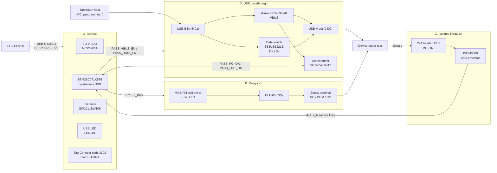

<!-- SPDX-License-Identifier: CERN-OHL-S-2.0 -->
Copyright (c) 2026 Martin Faltus (mafaltu)

# BenchHand r1 - hardware design overview

BenchHand is a USB-controlled bench tool. One USB-C port to the PC carries both power and a plain text serial
protocol, and through it the PC drives five relays, a switched USB 2.0 High Speed passthrough, and reads four isolated
digital inputs and six buttons. Everything is built around one STM32C071 microcontroller.

The r1 board silkscreen says **USB-DEBUG-CTRL r1** (date code 2643). That was the working name before the project
became BenchHand; it is the same board.

**Files**

| What | Where |
|---|---|
| Schematic (PDF) | [benchhand-r1-schematic.pdf](benchhand-r1-schematic.pdf) |
| KiCad 10 project | [../kicad/usb_debug_ctrl/](../kicad/usb_debug_ctrl/) |
| Bill of materials (distributor neutral) | [../bom/](../bom/) |
| Gerbers, drill, pick-and-place, assembly drawings | [../fabrication/](../fabrication/) |
| Assembly notes | [../fabrication/benchhand-r1-assembly-notes.md](../fabrication/benchhand-r1-assembly-notes.md) |
| Known issues of r1 | [known-issues.md](known-issues.md) |
| Datasheet links | [datasheets.md](datasheets.md) |
| Why things are the way they are | [../../docs/design-decisions.md](../../docs/design-decisions.md) |
| Firmware and serial protocol | [../../firmware/README.md](../../firmware/README.md) |

## Block diagram



Board edges (top view): USB-C control port on the right short edge; USB-B passthrough input on the upper long edge;
everything that goes to the device under test (USB-A output, five relay terminals, input header) on the lower long
edge. Buttons and LEDs face up through the enclosure lid.

### Power domains

| Domain | Source | Feeds |
|---|---|---|
| `CONTROL_5V` | USB-C VBUS (J101) | relay coils, coil LEDs, 3.3 V LDO |
| `CONTROL_3V3` | MCP1703A LDO | MCU, data switch, status buffer, all pull-ups |
| `PASS_IN_5V` / `PASS_OUT_5V` | USB-B VBUS (J401), through the eFuse | USB-A VBUS (J402) only |
| Relay contacts | none (dry contacts) | five separate NC / COM / NO groups |
| Inputs | the device under test | four separate IN+ / IN- pairs |

The passthrough 5 V never touches `CONTROL_5V`. GND is common to both USB paths: the passthrough is **not** isolated.
The relay contacts and the four input pairs are the isolated interfaces (functional isolation for low voltage, see
[Ratings](#key-ratings-and-limits)).

## A. Control block

**USB-C (J101, GCT USB4105-GF-A).** USB 2.0 device, Full Speed, enumerating as a CDC serial port. The board is a 5 V
sink: each CC pin has its own 5.1 kOhm Rd to GND, so both plug orientations and C-to-C / A-to-C cables work. No USB
Power Delivery. All four VBUS contacts are joined. Protection:

- D101 (TPD1E10B06, bidirectional ESD clamp) on `CONTROL_5V`, chosen for its very low leakage so the USB suspend
  current budget holds;
- U102 (TPD2E2U06, 1.5 pF) on D+ / D-;
- CC pins only see the Rd resistors, so they have no ESD part.

There is no fuse or PTC in `CONTROL_5V`: it would cost coil voltage, and the host port already limits current. Bulk
capacitance right on VBUS is kept small on purpose (C101 2.2 uF + C102 2.2 uF) to stay inside the USB attach
inrush limit, so do not increase those capacitors.

**3.3 V LDO (U104, MCP1703AT-3302E/CB).** 250 mA part, 16 V input rating, about 2 uA quiescent current. The real
3.3 V load is under 10 mA, so dropout is not a concern even at the low end of USB VBUS. C103 4.7 uF + C104 100 nF sit
at the MCU supply pins.

**MCU (U101, STM32C071K8T6, LQFP-32).** Arm Cortex-M0+ with native USB Full Speed. It runs **without a crystal**: the
USB clock comes from the internal HSIUSB48 oscillator, trimmed by the clock recovery system (CRS) against the host's
Start-of-Frame packets. NRST has a 100 nF capacitor. Every output that switches something (relay drivers, passthrough
enables) has an external pull-down, so everything stays OFF while the MCU is in reset, being programmed, or running
the ROM bootloader.

**Buttons (SW101..SW106).** Same Sky TS02 6x6 mm tactile switches with a 13 mm actuator that reaches through the lid.
Each has a 100 kOhm pull-up to 3.3 V and a 10 nF capacitor at the MCU pin (active low, about 1 ms RC, debounced in
firmware). SW101..SW105 belong to relays 1..5, SW106 to the USB passthrough. What they do is firmware behaviour; see
the [design decisions](../../docs/design-decisions.md) and the firmware README.

**USB LED (LED101).** 3 mm green THT LED driven from an MCU pin through 1 kOhm (about 1.4-2.5 mA). Firmware shows
the passthrough state on it and switches it off in USB suspend.

## B. Relays (five identical channels)

Per channel n (n = 1..5):

- **Relay K20n**: Hongfa HFD4/5, 5 V coil (178 Ohm nominal), DPDT, gold-plated AgNi contacts. Only one pole is used,
  as a changeover (NC / COM / NO); the second pole is left unconnected and never paralleled.
- **Driver**: MCU pin `RLYn_DRV` -> 100 Ohm -> gate of a DMN2056U low-side N-MOSFET (Q20n), 100 kOhm gate pull-down
  (relay OFF whenever the pin is not driven). 1N4148W flyback diode across the coil.
- **Coil LED (LED20n)**: from `CONTROL_5V` through 1.5 kOhm to the MOSFET drain. It lights when current really flows
  in the coil driver, without any GPIO.
- **Terminal (J20n)**: Same Sky TB002-500-03BE, 3-position 5.0 mm screw terminal, wire entry toward the board edge.
  Seen from outside, looking into the wire entries, the order is **NC, COM, NO** from left to right on every channel.

Coil current is about 28 mA nominal per relay (up to about 36 mA at the coil resistance tolerance limit). With all
five coils on, the board draws under 200 mA from the USB-C port; the firmware declares 250 mA to the host and
staggers coil switching.

Pick-up margin: the HFD4/5 is guaranteed to pull in at 3.75 V with a cold coil. With a hot coil and a weak USB port
the margin can run out, so supply the board from a port that keeps VBUS at or above about **4.6 V at the board**. The
4.5 V coil variant HFD4/4.5 fits the same footprint and gives more margin if you can buy it.

## C. Isolated digital inputs (four identical channels)

Per channel n (n = 1..4), each with its own `INn+` / `INn-` on header J301:

```
INn+ --[274R]--[274R]--+-----------+------> ISOM8600 input (anode)
                       |           |
                    1.15k shunt  1N4148W (antiparallel, reverse-polarity clamp)
                       |           |
INn- ------------------+-----------+------> ISOM8600 input (cathode)

ISOM8600 output: 22k pull-up to 3.3 V, then 1k / 10 nF RC -> MCU pin INn_N (low = input HIGH)
```

- **Isolator**: TI ISOM8600, an opto-emulator switch (functional isolation, not a certified safety barrier).
- **Thresholds**: guaranteed LOW for 0 to 1.0 V, guaranteed HIGH for 3.0 to 12 V between IN+ and IN-. Between 1 and
  3 V the state is undefined. The two 274 Ohm resistors are 1 % 1206 parts with TCR <= 100 ppm/K; the window depends on
  them, so do not substitute looser parts.
- **This is a current-driven input**, not a high-impedance logic probe: it takes about 3.7 mA at 3.3 V and about
  19.5 mA at 12 V from the signal source. A weak pull-up on a target (for example a reset line) may not drive it.
- **Reverse polarity** is clamped by the antiparallel diode (tested up to 5 V on the prototype; designed for 12 V).
- **Maximum 12 V.** 24 V is not supported: the series resistors would overheat.
- The four `IN-` returns are separate from each other and from board GND. Join them externally if your signals share
  a ground.

**Header J301** (Samtec TSW-104-08-F-D-RA, 2x4 right angle, 2.54 mm), viewed from outside the board:

| | IN1 | IN2 | IN3 | IN4 |
|---|---|---|---|---|
| upper row | IN1+ | IN2+ | IN3+ | IN4+ |
| lower row | IN1- | IN2- | IN3- | IN4- |

IN1 is on the left. Check the orientation on your board against the assembly drawing before wiring.

## D. Switched USB 2.0 passthrough

Upstream host -> **USB-B J401** (Molex 67068-8000) -> board -> **USB-A J402** (Molex 67643-0910) -> device under
test. VBUS and D+ / D- are switched separately; GND and the connector shells stay connected all the time. There is no
hub or protocol bridge: it is a switched physical connection that worked at USB 2.0 High Speed (480 Mbit/s) on the
prototype.

**VBUS: eFuse U401 (TI TPS259474LRPWR).**

- Enable `PASS_VBUS_EN` through 10 kOhm, with a 100 kOhm pull-down, so VBUS is OFF by default.
- Current limit set by R408 = 1.82 kOhm: 1.61 / 1.83 / 2.01 A (min / typ / max). The passthrough is rated **1.5 A
  continuous** because that is the rating of the USB-B and USB-A receptacles; the eFuse limit is short-circuit
  protection, not a 2 A rating.
- Circuit breaker with **latch-off**: an overload longer than the blanking time (C404 2.2 nF, about 1-3.5 ms) switches
  the output off and keeps it off until EN is toggled low or input power is cycled.
- **True reverse blocking**: a self-powered device on the USB-A side cannot feed back into the USB-B side.
- Overvoltage lockout (R401 / R402 = 100k / 27k): trips at 5.48-5.84 V, so a source above about 5.5 V is cut off.
- Soft start (C403 3.9 nF): typical rise time about 10-12 ms.
- TVS D401 / D402 (SMF6.0A) on input and output VBUS, 4.7 kOhm bleed R409 on the output, optional Schottky clamp D405
  (not fitted).

**Data: switch U402 (TI TS3USB221ERSER).** A 1:2 USB 2.0 HS analog switch used as an on/off switch on port 1 only;
the unused port is terminated with 49.9 Ohm. Its active-low /OE is pulled up to 3.3 V and driven through an inverter
MOSFET Q401, so `PASS_DATA_EN` high = data connected, and the default (MCU in reset, or no 3.3 V at all) is
**disconnected**. ESD arrays D403 / D404 (TPD2E2U06) sit at both connectors.

**Status: buffer U403 (TI SN74LVC2G17).** Two Schmitt-trigger buffers powered from 3.3 V with 5.5 V tolerant inputs,
so no 5 V signal reaches an MCU pin directly:

| Signal | Comes from | HIGH means |
|---|---|---|
| `PASS_PG_OK` | eFuse power-good (PG threshold on the input side, PG asserts for VBUS in >= 4.16 V) | eFuse is on and healthy |
| `PASS_OUT_OK` | 4.7k / 5.6k divider on `PASS_OUT_5V` | output VBUS really present (HIGH for >= 4.23 V, LOW for <= 1.52 V) |

**Sequencing (implemented in firmware).**

- Connect: VBUS on -> wait until both `PASS_PG_OK` and `PASS_OUT_OK` are HIGH (ramp allowance 100 ms) -> data on.
- Disconnect: data off -> VBUS off.
- Fault (either status LOW while enabled): data off first, then VBUS off; the fault stays latched until the host sends
  an explicit re-arm.
- No upstream power on USB-B is reported as "no input", not as a fault, and is retried every 2 s.

Known limitation: if the upstream source goes into overvoltage while a self-powered device holds the USB-A VBUS up,
both status signals can stay HIGH and the data lines can stay connected while the eFuse blocks the overvoltage. This
creates no hazard for the device, which keeps its own supply.

## Key ratings and limits

| Item | Value |
|---|---|
| Control port | USB-C, USB 2.0 Full Speed CDC serial, 5 V sink, no USB PD |
| Board supply current | < 10 mA idle on 3.3 V; about 200 mA worst case with all five coils on; 250 mA declared to the host |
| Relay contacts | product rating **1 A at up to 30 V DC, resistive load**; one changeover (NC / COM / NO) per channel |
| Relay coil supply | keep USB VBUS >= about 4.6 V at the board for guaranteed pick-up with a hot coil |
| Isolated inputs | LOW 0-1.0 V, HIGH 3.0-12 V, about 3.7 mA at 3.3 V / 19.5 mA at 12 V, reverse-polarity protected, **max 12 V** |
| Isolation | functional only, **>= 1.0 mm** copper clearance between domains (1.49 mm relays, 1.04 mm inputs); **not for mains** |
| USB passthrough | USB 2.0 up to High Speed 480 Mbit/s, **1.5 A** continuous, current limit 1.61-2.01 A with latch-off |
| Passthrough input voltage | overvoltage lockout from 5.48-5.84 V |
| Passthrough isolation | none (GND shared with the control port) |
| Operating environment | indoor bench use; no temperature testing done |

## MCU pin map (STM32C071K8T6, LQFP-32)

| Pin | Port | Net | Direction | Meaning |
|---|---|---|---|---|
| 12 | PA5 | RLY1_DRV | out | relay 1 coil, high = ON |
| 11 | PA4 | RLY2_DRV | out | relay 2 coil, high = ON |
| 8 | PA1 | RLY3_DRV | out | relay 3 coil, high = ON |
| 7 | PA0 | RLY4_DRV | out | relay 4 coil, high = ON |
| 27 | PB3 | RLY5_DRV | out | relay 5 coil, high = ON |
| 15 | PB0 | BTN_RLY1 | in | relay 1 button, active low |
| 10 | PA3 | BTN_RLY2 | in | relay 2 button, active low |
| 2 | PC14 | BTN_RLY3 | in | relay 3 button, active low |
| 1 | PB9 | BTN_RLY4 | in | relay 4 button, active low |
| 32 | PB8 | BTN_RLY5 | in | relay 5 button, active low |
| 16 | PB1 | BTN_USB | in | USB passthrough button, active low |
| 14 | PA7 | LED_USB | out | USB LED, high = on |
| 9 | PA2 | IN1_N | in | isolated input 1, low = input HIGH |
| 31 | PB7 | IN2_N | in | isolated input 2, low = input HIGH |
| 30 | PB6 | IN3_N | in | isolated input 3, low = input HIGH |
| 29 | PB5 | IN4_N | in | isolated input 4, low = input HIGH |
| 17 | PB2 | PASS_VBUS_EN | out | passthrough VBUS (eFuse enable), high = ON |
| 18 | PA8 | PASS_DATA_EN | out | passthrough D+ / D-, high = connected |
| 28 | PB4 | PASS_PG_OK | in | eFuse power good, high = OK |
| 26 | PA15 | PASS_OUT_OK | in | output VBUS present, high = OK |
| 22 / 23 | PA11 / PA12 | USBC_DN / USBC_DP | - | USB Full Speed device (control port) |
| 24 / 25 | PA13 / PA14 | SWDIO / SWCLK | - | SWD |
| 19 / 21 | PA9 / PA10 | PROG_TX / PROG_RX | - | USART1 on the programming pads (ROM UART bootloader, optional debug log) |
| 6 | NRST | NRST | - | reset, 100 nF |
| 4 / 5 | VDD / VSS | CONTROL_3V3 / GND | - | supply |
| 3, 13, 20 | PC15, PA6, PC6 | - | - | not connected |

The relay drivers, LED and passthrough enables sit on pins that the ROM bootloader never drives as outputs (it
leaves them untouched or as inputs with pull-down), so nothing switches on while the MCU is being programmed. All input pins use distinct EXTI lines.

## Programming and debug: Tag-Connect TC2050 pads (J102)

J102 is a footprint for a **Tag-Connect TC2050-IDC-NL** (no-legs) cable: ten copper pads plus three guide holes, no
connector, no solder. You press the cable onto the pads.

| Pad | Signal | Pad | Signal |
|---|---|---|---|
| 1 | not connected | 6 | GND |
| 2 | SWDIO | 7 | PROG_TX (PA9, USART1 TX) |
| 3 | NRST | 8 | not connected |
| 4 | PROG_RX (PA10, USART1 RX) | 9 | SWCLK |
| 5 | GND | 10 | not connected |

Important:

- **This is not the standard ARM 10-pin / Tag-Connect SWD pinout.** It is a custom pad assignment. Check your cable or
  adapter wiring against this table before connecting.
- **There is no VTref / 3.3 V on the pads.** The programmer must use its own logic reference. If it needs a target
  voltage, take 3.3 V from test pad TP102.
- Keep the SWD clock at **100 kHz** on r1 (see [known issues](known-issues.md)).
- The board must be powered from the USB-C port while programming.
- After the first flash you can update firmware without the cable: the firmware `BOOTLOADER` command starts the ROM
  USB DFU bootloader on the USB-C port (see the firmware README).

## Test pads

18 bare 1.0 mm copper pads on the **bottom** side, no parts fitted. None sits on a USB data line or on an isolated
input net.

| Pad | Net | Pad | Net |
|---|---|---|---|
| TP101 | CONTROL_5V | TP201 | GND |
| TP102 | CONTROL_3V3 (also a 3.3 V reference for the programmer) | TP301 | GND |
| TP103 | GND | TP401 | PASS_IN_5V |
| TP104 | NRST | TP402 | PASS_OUT_5V |
| TP105 | RLY1_DRV | TP403 | PASS_OUT_OK |
| TP106 | RLY2_DRV | TP404 | PASS_VBUS_EN |
| TP107 | RLY3_DRV | TP405 | PASS_DATA_EN |
| TP108 | RLY4_DRV | TP406 | GND |
| TP109 | RLY5_DRV | TP407 | PASS_PG_OK |

## PCB facts

| Item | Value |
|---|---|
| Size | 188.8 x 40 mm, 1 mm corner radius |
| Stackup | 2 layers, FR-4, 1.6 mm, 1 oz copper |
| Finish / mask | lead-free HASL on the prototype (any finish works), any mask colour |
| Vias | 0.3 mm drill / 0.6 mm pad, tented |
| Design rules | conservative 2-layer rules (track >= 0.15 mm, clearance >= 0.1524 mm) that fit standard prototype fabs; no impedance control ordered |
| Mounting | 4 x M3 non-plated holes, 3.2 mm |
| Parts | all SMD on top (stencil 0.12 mm + reflow), all THT hand-soldered afterwards |
| Connectors | mating faces overhang the board edge by about 2 mm to meet a 2 mm enclosure wall |
| Marking | silkscreen "USB-DEBUG-CTRL r1", date code 2643 on the bottom |

The USB HS passthrough pairs are routed as short coplanar pairs over a solid ground plane, about 90 Ohm by
calculation, but the board was not ordered with impedance control. See [known issues](known-issues.md).

## 3D models

The KiCad project ships with the 3D models we made ourselves, and KiCad's stock libraries provide the common parts.
The manufacturers' 3D models of four parts are **not** included in this repository. Their licences don't allow
redistribution. Download them from the manufacturer (free, usually needs an account) and save them under
`hardware/kicad/lib/3d/` with the file name shown in the table.

| Part | Refs | Manufacturer model | Save as |
|---|---|---|---|
| Hongfa HFD4/5 relay (THT) | K201-K205 | Hongfa HFD4 series STEP | `HFD4_THT.step` |
| Molex 67068-8000 USB-B | J401 | Molex product page, 3D model (STEP) | `Molex_67068-8000.step` |
| Same Sky TB002-500-03BE terminal block | J201-J205 | Same Sky product page, 3D model (STEP) | `Same_Sky_TB002-500-03BE.step` |
| Same Sky TS02-66-130-BK-160-LCR-D button | SW101-SW106 | Same Sky product page, 3D model (STEP) | `Same_Sky_TS02-66-130-BK-160-LCR-D.step` |

Without them, KiCad's 3D viewer simply leaves those parts out. Gerbers, BOM and placement data don't depend on them.
Links to the product pages are in [datasheets.md](datasheets.md).
